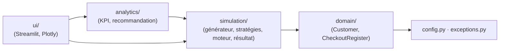
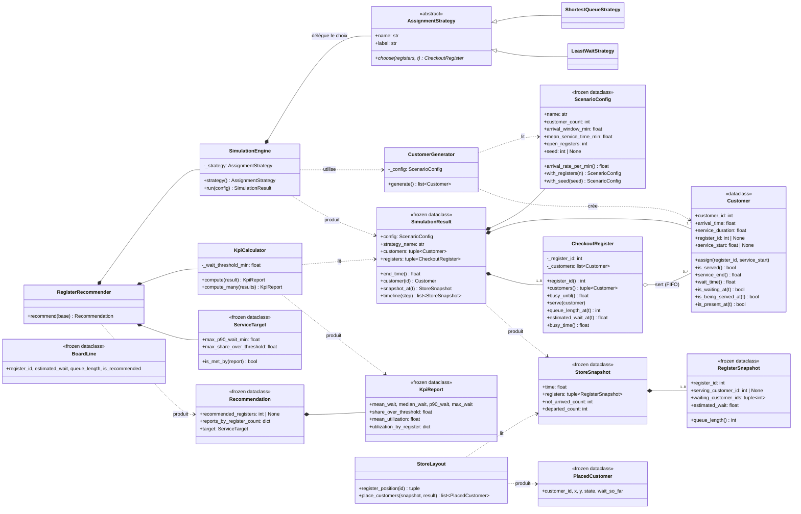

# RetailFlow | Architecture et choix de conception

## Architecture de l’application V8

`app.py` est l’entrée Streamlit. Les cinq espaces partagent configuration latérale, thème et historique de navigation. La scène utilise `ui/dynamic_view.py` pour ses réglages et actions. `ui/dynamic_dashboard.py` analyse le même résultat, et les deux objectifs d’optimisation utilisent les tirages de `analytics/decision_lab.py`. Les analyses et comparaisons FIFO restent accessibles avec leur propre périmètre.

Le journal dynamique alimente les trajectoires et les séries KPI en Python. Le Canvas lit les trajectoires et émet les commandes. Les exports reprennent les tables affichées. Voir [les contrats analytiques](DICTIONNAIRE_KPI_DYNAMIQUES.md) et [les arbitrages](INTEGRATION_MISSION_3.md).

Les sections suivantes documentent aussi les choix et contrats historiques du moteur FIFO.

## Architecture en couches

Les dépendances vont **dans un seul sens**. Une couche n'importe jamais une couche située au-dessus d'elle.

- **Seul `ui/` importe Streamlit.** Le moteur et les KPI se testent donc sans interface.
- Dans `ui/`, la logique calculable est séparée du rendu :
  `store_layout.py` et `client_board.py` sont **purs et testés**, tandis que `store_view.py`,
  `client_screen.py`, `sidebar.py` et `dashboard.py` ne font qu'afficher.
- `app.py` ne fait qu'assembler : il lit la barre latérale, lance la simulation (mise en cache)
  et appelle les 3 fonctions de rendu.

## Diagramme de classes (UML)

Fonctions (hors classes) : `build_strategy` et le registre `STRATEGIES` (stratégies),
`compare_strategies`, `compare_scenarios`, `run_replications` et `relative_gain`
(`analytics/comparison.py`), `build_board` et `format_minutes` (`ui/client_board.py`),
`wait_level`, `describe_status` et `animation_step` (`ui/store_layout.py`).

## Responsabilités

| Classe / module | Responsabilité unique |
|---|---|
| `ScenarioConfig` | décrire un scénario **valide** (validation à la création, immuable) |
| `Customer` | connaître son propre parcours : arrivée, début, fin, attente, état à l'instant t |
| `CheckoutRegister` | servir ses clients en FIFO sans chevauchement, et répondre « combien de clients ? combien d'attente ? » |
| `CustomerGenerator` | produire des clients aléatoires mais reproductibles |
| `AssignmentStrategy` et ses sous-classes | choisir une caisse |
| `SimulationEngine` | orchestrer : générer, faire choisir, faire servir |
| `SimulationResult` | exposer le résultat et reconstituer l'état du magasin à tout instant |
| `KpiCalculator` | transformer des résultats en indicateurs |
| `RegisterRecommender` | trouver le plus petit nombre de caisses qui atteint la `ServiceTarget` |
| `StoreLayout` | calculer la géométrie de la vue 2D |
| `build_board` | calculer le contenu du panneau client |

## Choix de conception (et pourquoi)

1. **Composition et polymorphisme pour les comportements.** Le moteur *a* une stratégie et lui
   délègue le choix. Ajouter un comportement ne touche ni au moteur ni à l'interface : il suffit
   d'une sous-classe et d'une entrée dans `STRATEGIES` (principe ouvert/fermé). C'est le seul
   héritage du projet, et c'est là qu'il apporte de la valeur.
2. **Objets immuables aux frontières.** `ScenarioConfig`, `SimulationResult`, les snapshots et
   les rapports sont des `frozen dataclass`. L'interface ne peut donc pas modifier un résultat
   par erreur, et le cache Streamlit est sûr.
3. **Encapsulation de la caisse.** La liste `_customers` est privée, n'est exposée qu'en
   `tuple` et n'est alimentée que par `serve()`. L'invariant « pas de chevauchement » ne
   peut donc pas être violé de l'extérieur.
4. **Une seule définition de chaque notion (DRY).** L'attente est `Customer.wait_time`, la
   « longueur de file » est le nombre de clients présents (domaine et snapshot), et toutes
   les durées passent par `format_minutes`.
5. **Validation précoce et erreurs typées.** Une configuration invalide ne peut pas exister.
   Les erreurs métier héritent de `QueueSmartError`, avec des messages en français affichés
   tels quels par l'interface (`st.error`, `st.warning`), jamais de traceback.
6. **Recommandation robuste.** Une seule simulation dépend trop du hasard. Pour chaque nombre
   de caisses de 1 à 8, on lance 20 simulations (graines `seed`, `seed+1`, …) et on regroupe
   les attentes de tous les clients avant de calculer le p90. On retient le **plus petit**
   nombre de caisses qui respecte la cible, car chaque caisse coûte du personnel.
7. **Constantes centralisées.** Les valeurs métier sont dans `config.py`. Les constantes
   d'affichage (couleurs, tailles, pas d'animation) sont nommées en tête de leur module `ui/`.
8. **Simplicité.** Dans le moteur historique, il n'y a pas de simulation à événements discrets : en FIFO sans abandon,
   le début de service se calcule à l'arrivée, et une boucle suffit.

## Extensions au contrat d'interface initial

Elles ajoutent des éléments sans rien modifier de l'existant :

- `Customer.is_present_at(t)` : « en attente ou en service ». Elle évite de répéter cette
  condition dans `CheckoutRegister` et dans les snapshots ;
- constantes `MAX_SHARE_OVER_THRESHOLD` et bornes de saisie (`MAX_CUSTOMER_COUNT`, …) dans `config.py` ;
- module `analytics/comparison.py` : répétition de simulations et comparaisons, partagées par
  le recommandeur et le dashboard (DRY) ;
- `wait_level`, `describe_status` et `animation_step` dans `ui/store_layout.py` : logique pure de l'animation.

## Évolution de l'architecture

RetailFlow conserve le package Python historique `queuesmart` afin de préserver les imports et les tests. Deux moteurs coexistent : `SimulationEngine` (FIFO historique, utilisé dans `app.py`) et `DynamicSimulationEngine` (événements discrets, validé dans `dynamic_demo.py`). Les résultats `SimulationResult` et `DynamicResult` ne sont pas interchangeables : les analyses dynamiques doivent utiliser un adaptateur ou des KPI dédiés.

Le schéma et les choix précédents documentent surtout l'architecture initiale. Depuis la livraison V7, la scène 2D et les espaces d'analyse sont intégrés dans `app.py`. Les paragraphes précédents décrivent les choix historiques de conception.
