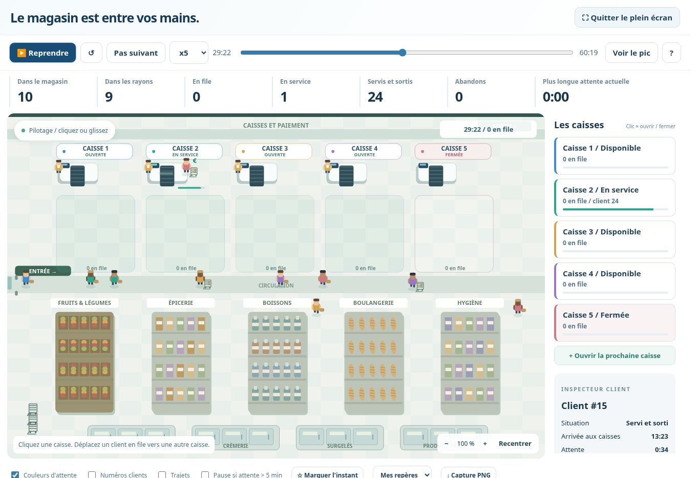

# RetailFlow : atelier interactif V6

## Objectif

Passer d'un petit lecteur de trajectoires à un atelier de décision : on observe,
on intervient, puis on compare les effets à un scénario témoin.

## Expérience proposée

| Fonction | Utilité |
|---|---|
| Toute la largeur de l'application | Exploiter les grands écrans sans colonne vide réservée à la barre latérale |
| Vue Simulation affichée au démarrage | Arriver directement dans le magasin |
| Mode immersion et zoom jusqu'à x3 | Agrandir la scène et ses personnages |
| Déplacement de la caméra | Explorer une zone précise à la souris |
| Nouveaux personnages et comptoirs | Lecture plus nette des files, des caissiers et du service en cours |
| Couleurs d'attente | Distinguer une attente courte, intermédiaire ou supérieure à 5 minutes |
| Cliquer une caisse ou sa carte | Ouvrir ou fermer réellement la caisse dans le moteur |
| Glisser un client en file vers une autre caisse | Réaffecter le client sans modifier son arrivée ou sa patience |
| Annuler et réinitialiser | Comparer, essayer et revenir sur une décision |
| Témoin à clientèle identique | Comparer les files et les résultats avec et sans interventions |
| Indicateurs en direct | Lire les présents, les files, le service, les départs et l'attente actuelle |
| Bilan final séparé | Éviter de confondre les compteurs à l'instant affiché et les résultats complets |
| Analyse en direct | Expliquer ce qui se passe au moment observé |
| Commentaires finaux chiffrés | Expliquer le pic de file, l'affluence, le niveau de service et une piste à tester |
| Affluence soutenue et pic du samedi | Construire une situation où les décisions sont visibles |
| Pause automatique au seuil | Arrêter la lecture quand une attente dépasse 5 minutes |
| Vitesses x1 à x50 | Parcourir rapidement une simulation longue |
| Pas suivant et visite du pic | Examiner un événement ou le moment de congestion maximale |
| Douze repères temporels | Retrouver les instants intéressants pendant l'expérience |
| Inspecteur client | Lire la situation, l'arrivée, l'attente et le service prévu du client choisi |
| Numéros et trajets affichables | Suivre les parcours sans encombrer la scène par défaut |
| Capture PNG | Emporter une image de la scène pour la présentation |
| Export CSV et JSON | Conserver les événements, les clients et les interventions reproductibles |
| Graphiques agrandis | Améliorer la lecture des axes, des légendes et des comparaisons |



## Supermarché et parcours de courses

L'espace consacre une zone aux caisses et une autre aux rayons. Les profils de
démonstration sont modérés : 80 clients en 60 min pour l'affluence soutenue,
110 clients en 60 min et quatre caisses pour le pic du samedi. Ce sont des hypothèses
synthétiques, pas des mesures d'un magasin réel. Une fermeture excessive peut
naturellement recréer une file importante.

Les courses avant caisse sont représentées par des parcours synthétiques de 4 à
10 minutes, avec une pause devant un rayon. Certains clients ont donc commencé leurs
courses avant le début de la période affichée. Les arrivées aux caisses et leurs
résultats restent ceux du moteur Python. Le compteur « Dans les rayons » décrit cette
phase illustrative ; « Dans le magasin » additionne cette population et celle de la
zone des caisses. Les temps d'attente et le niveau de service portent sur les caisses.

## Règles de simulation

Les gestes remontent à Python. Le navigateur dessine et lit les résultats, il ne décide
pas de l'affectation des clients et ne fabrique pas les KPI.

- Une caisse fermée termine son service en cours et réaffecte ses clients encore en file.
- La dernière caisse ouverte ne peut pas être fermée.
- Seul un client encore en file peut être déplacé. Une caisse fermée n'accepte pas de dépôt.
- Le client est ajouté en fin de la file choisie. Son arrivée et sa patience restent identiques.
- Une réaffectation manuelle est conservée jusqu'au service ou à une fermeture de caisse ;
  le rééquilibrage automatique ne l'annule pas aussitôt.
- Le passé avant l'instant d'intervention reste identique. Les gestes au même instant
  conservent l'ordre dans lequel ils ont été effectués.
- Les actions déjà enregistrées restent dans l'expérience lors d'un retour en arrière.
  Le bouton d'annulation retire la dernière action enregistrée.
- Les indicateurs de fin sont recalculés après chaque action. Ils sont distincts des
  compteurs de l'instant affiché dans la scène.

La comparaison au témoin est une expérience contrôlée sur données synthétiques : mêmes
arrivées et durées de service prévues. Elle ne garantit pas les mêmes effets dans un magasin
réel. Le niveau de service a pour dénominateur tous les arrivants ; un abandon reste un échec.

## Architecture

- `frontend_studio/` : HTML/CSS, caméra, dessin, lecture des événements et interactions.
- `queuesmart/ui/studio_component.py` : composant bidirectionnel et données de la scène.
- `queuesmart/analytics/interventions.py` : validation des commandes et état du moteur.
- `queuesmart/analytics/narrative.py` : commentaires calculés et comparaison au témoin.
- `queuesmart/simulation/dynamic.py` : prise en charge des commandes manuelles ordonnées.
- `queuesmart/ui/dynamic_view.py` : assemblage, annulation, bilan, analyses et exports.

Le composant utilise l'API intégrée à la version de Streamlit épinglée dans le dépôt.
Aucune compilation JavaScript, bibliothèque graphique supplémentaire ni clé d'API n'est nécessaire.
Le lecteur 2D précédent reste conservé pour les tests et les exports historiques.

## Démarrage

Depuis le dossier RetailFlow :

```powershell
python -m pip install -r requirements.txt
python -m streamlit run app.py
```

Dans Simulation, ouvrir le mode immersion, puis cliquer « Voir le pic » pour tester
les réaffectations sur une file. Les défis sont dans « Réglages de l'atelier et défis d'affluence ».

## Validation et limites

- Tests Python : invariants du moteur, gestes manuels, ordre des actions au même instant,
  conservation du passé et de la patience, commandes impossibles, annulation et interfaces.
- Tests JavaScript : lecture du temps, conservation des clients, transferts, fermetures,
  abandons et retours en arrière.
- Contrôles réels dans le navigateur sur ordinateur : grande largeur, immersion,
  glisser-déposer, fermeture d'une caisse occupée et réaffectation, annulation, défi
  d'affluence, graphique de comparaison au témoin.
- L'affichage mobile dispose de règles adaptées ; une validation sur appareil mobile
  reste à effectuer.
- L'atelier dynamique représente cinq caisses. Le comparateur historique reste séparé
  et peut tester jusqu'à huit caisses.
- Les trajets sont visuels. Les décisions et les temps métier viennent du moteur.
- Les repères temporels et la caméra sont conservés localement dans l'onglet. Pour
  archiver une expérience reproductible, exporter le JSON des paramètres et interventions.


## Complément V6.1

La finalisation conserve cet atelier. Le curseur serveur est désormais consommé une
seule fois ; les retours temporels ne modifient plus les instantanés déjà lus.
Les commandes sont appliquées après les événements automatiques déjà connus au même
instant. Leur ordre de saisie est conservé lorsqu'elles partagent cet instant.

Recherchez un client par identifiant pour consulter son état et sa chronologie connus
à l'instant affiché. Le champ de destination et le bouton Réaffecter proposent une
alternative au glisser-déposer. Un client en service ne peut pas être déplacé.

Le journal distingue décisions appliquées, futures et devenues inapplicables après
une modification du passé. Les états avant et après sont issus du moteur. La comparaison
présente l'effet combiné face au témoin, sans l'attribuer à la dernière décision.

Le mode soutenance guide l'oral sans cacher les contrôles. Les cinq formats CSS testés,
les mesures, les captures et les limites sont détaillés dans
[le rapport V6.1](FINALISATION_RETAILFLOW_V6_1.md).
